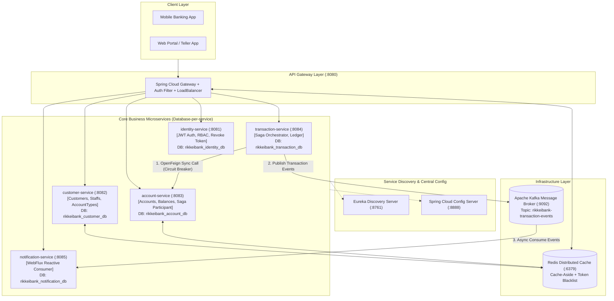
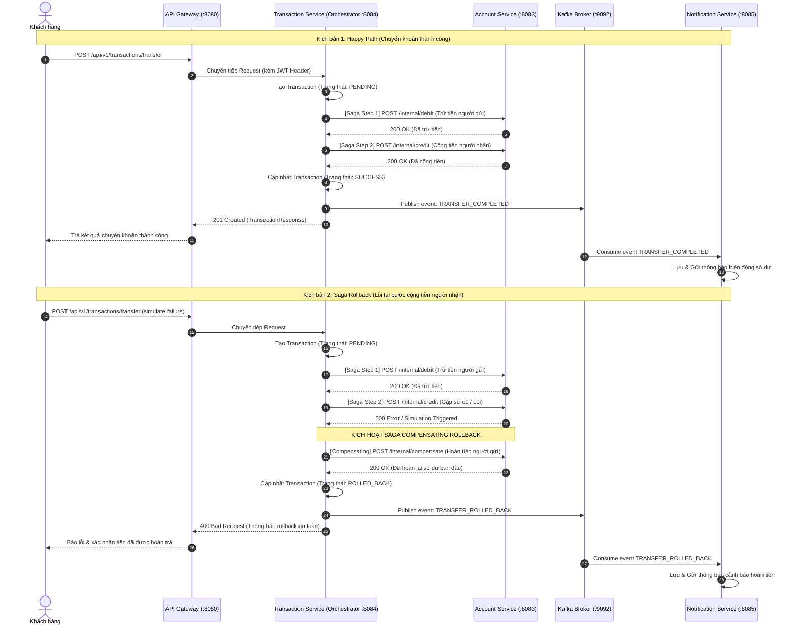

# Ngân hàng số "RikkeiBank API" - Mini Project SRS & Microservice Solution

> **Dự án**: Hệ thống Backend Microservices Ngân hàng số RikkeiBank  
> **Lĩnh vực**: Tài chính – Ngân hàng (Fintech)  
> **Khách hàng**: Chi nhánh ngân hàng bán lẻ RikkeiBank  
> **Môi trường**: Java 17/21, Spring Boot 3.2.x, Spring Cloud 2023.0.x, Apache Kafka, Redis, Spring Cloud Gateway, Netflix Eureka, OpenFeign, Resilience4j Circuit Breaker, Spring WebFlux.

---

## I. Tổng quan về Dự án & Phân tích Kiến trúc (Architecture Analysis)

### 1. Bối cảnh & Mục tiêu
Khách hàng **RikkeiBank** chuyển dịch toàn bộ hệ thống từ mô hình Monolithic tập trung sang kiến trúc **Microservices (MSA)** phân tán. Hệ thống đóng vai trò Backend Web Service cung cấp API chuẩn RESTful cho các ứng dụng Mobile App (iOS/Android) và Web App ngân hàng số trong tương lai.

### 2. So sánh Monolithic vs SOA vs Microservices (Lý do lựa chọn MSA)

| Tiêu chí | Monolithic Architecture | SOA (Service-Oriented Architecture) | Microservices Architecture (MSA) - RikkeiBank |
| :--- | :--- | :--- | :--- |
| **Tính độc lập của Service** | Tất cả module chung 1 khối mã nguồn | Các service to, phụ thuộc Enterprise Service Bus (ESB) | Hoàn toàn độc lập, deploy và scale riêng lẻ theo tải |
| **Cơ sở dữ liệu (Database)** | Database tập trung (Shared DB) gây nghẽn cổ chai | Thường dùng chung Shared Database | **Database-per-service**: Mỗi service quản trị DB riêng |
| **Khả năng chịu lỗi (Fault Isolation)** | 1 module lỗi có thể sập toàn bộ hệ thống | Phụ thuộc độ sẵn sàng của ESB | **Resilience4j Circuit Breaker**: Cô lập lỗi, chống cascading failure |
| **Mở rộng (Scalability)** | Phải scale toàn bộ ứng dụng | Scale theo các cụm lớn | Scale độc lập từng service (ví dụ Account/Transaction cần tải cao) |
| **Giao tiếp (Communication)** | In-memory method call | Giao thức SOAP/XML cồng kềnh qua ESB | RESTful JSON nhẹ + Event-Driven bất đồng bộ qua **Kafka** |

---

## II. Sơ đồ Kiến trúc Hệ thống (System Architecture)



---

## III. Chi tiết các Microservice & Thiết kế Dữ liệu (Database-per-service)

### 1. `identity-service` (Port: 8081)
- **Chức năng**: Xác thực tập trung, đăng ký, đăng nhập cấp JWT Access Token (24h) & Refresh Token (7 ngày).
- **Phân quyền RBAC**:
  - `ROLE_ADMIN`: Quản trị hệ thống, ép buộc đăng xuất tài khoản rủi ro (`POST /api/v1/auth/revoke`).
  - `ROLE_TELLER`: Giao dịch viên thực hiện và tra cứu giao dịch theo ca trực.
  - `ROLE_CUSTOMER`: Khách hàng xem số dư, lịch sử giao dịch và chuyển khoản.
- **Cơ chế Token Revocation / Force Logout**: Admin có thể thu hồi token ngay lập tức bằng cách ghi mã token hoặc cờ hủy phiên vào Redis Blacklist (`blacklist:<token>`).
- **Database**: `rikkeibank_identity_db` (Entity: `User`, `user_roles`).

### 2. `customer-service` (Port: 8082)
- **Chức năng**: Quản lý danh mục Khách hàng (`Customer`), Nhân viên/Giao dịch viên (`Staff`), Danh mục loại tài khoản (`AccountType`).
- **Distributed Caching (Redis Cache-Aside)**:
  - `@Cacheable(value = "customers", key = "#id")`: Tối ưu truy vấn hồ sơ khách hàng.
  - `@CachePut`: Cập nhật đồng thời DB và Cache khi có chỉnh sửa.
  - `@CacheEvict`: Xóa cache khi xóa hồ sơ.
- **Database**: `rikkeibank_customer_db` (Entities: `Customer`, `Staff`, `AccountType`).

### 3. `account-service` (Port: 8083)
- **Chức năng**: Quản lý tài khoản thanh toán / tiết kiệm, số dư biến động (Nạp, Rút, Giữ tiền/Trừ tiền/Cộng tiền).
- **Saga Participant**: Cung cấp API nội bộ cho Saga Orchestrator:
  - `POST /api/v1/accounts/internal/debit`: Khấu trừ tiền tài khoản nguồn.
  - `POST /api/v1/accounts/internal/credit`: Cộng tiền vào tài khoản đích.
  - `POST /api/v1/accounts/internal/compensate`: Hoàn tiền (Rollback/Compensating) khi bước sau bị lỗi.
- **Database**: `rikkeibank_account_db` (Entity: `Account` với `@Version` chống Race Condition).

### 4. `transaction-service` (Port: 8084)
- **Chức năng**: Quản lý giao dịch, đóng vai trò **Saga Orchestrator** thực hiện chuyển khoản phân tán.
- **Saga Flow**:
  1. Tạo bản ghi giao dịch trạng thái `PENDING`.
  2. Gọi `account-service` qua OpenFeign trừ tiền người gửi.
  3. Gọi `account-service` qua OpenFeign cộng tiền người nhận.
  4. Nếu thành công: Đánh dấu `SUCCESS`, phát sự kiện `TRANSFER_COMPLETED` lên Kafka.
  5. Nếu lỗi ở bước cộng tiền (hoặc kích hoạt cờ test `simulateReceiverCreditFailure: true`): Gọi API `compensate` của `account-service` để hoàn tiền người gửi, đánh dấu trạng thái `ROLLED_BACK`, phát sự kiện `TRANSFER_ROLLED_BACK` lên Kafka.
- **Báo cáo TELLER**: Tra cứu giao dịch trong ngày theo giao dịch viên (`GET /api/v1/transactions/teller/daily`).
- **Database**: `rikkeibank_transaction_db` (Entity: `Transaction`).

### 5. `notification-service` (Port: 8085)
- **Chức năng**: Xử lý bất đồng bộ (Reactive WebFlux + Kafka Consumer).
- **Consumer**: Lắng nghe topic `rikkeibank-transaction-events`, tự động tạo thông báo biến động số dư / hoàn tiền gửi đến người dùng.
- **Reactive Streaming**: Hỗ trợ Server-Sent Events (SSE) `/api/v1/notifications/stream`.
- **Database**: `rikkeibank_notification_db` (R2DBC Entity: `Notification`).

---

## IV. Luồng Nghiệp vụ Chuyển khoản với Saga Pattern



---

## V. Kháng lỗi (Fault Tolerance) & Circuit Breaker (Resilience4j)

Hệ thống áp dụng mô hình Circuit Breaker 3 trạng thái giữa `transaction-service` và `account-service`:
1. **CLOSED**: Mọi request chuyển tiếp bình thường. Tỷ lệ lỗi được ghi nhận trong Sliding Window (5 calls).
2. **OPEN**: Khi tỷ lệ lỗi vượt ngưỡng 50% (`failure-rate-threshold: 50`), Circuit Breaker chuyển sang trạng thái OPEN, ngắt kết nối trực tiếp đến service phụ thuộc và chuyển sang gọi hàm Fallback ngay lập tức để chống Cascading Failure (lỗi dây chuyền).
3. **HALF-OPEN**: Sau khoảng thời gian chờ `wait-duration-in-open-state: 10000ms`, cho phép 2 request thăm dò (`permitted-number-of-calls-in-half-open-state: 2`). Nếu thành công chuyển về CLOSED, nếu thất bại quay lại OPEN.

---

## VI. Hướng dẫn Khởi chạy Hệ thống (Step-by-step Run Guide)

### Bước 1: Khởi động Hạ tầng Docker (Kafka, Zookeeper, Redis)
Mở PowerShell tại thư mục `excercise/session18`:
```powershell
docker-compose up -d
```
Kiểm tra trạng thái các container:
```powershell
docker-compose ps
```

### Bước 2: Khởi động các Microservice theo thứ tự
Chạy từng service theo thứ tự sau (mở các tab terminal riêng biệt hoặc dùng IDE):

1. **Discovery Server (Eureka)**:
   ```powershell
   cd discovery-server
   mvn spring-boot:run
   ```
   *Dashboard kiểm tra: `http://localhost:8761`*

2. **Config Server**:
   ```powershell
   cd config-server
   mvn spring-boot:run
   ```

3. **API Gateway**:
   ```powershell
   cd gateway-service
   mvn spring-boot:run
   ```
   *Cổng Gateway chính: `http://localhost:8080`*

4. **Identity Service**:
   ```powershell
   cd identity-service
   mvn spring-boot:run
   ```

5. **Customer Service**:
   ```powershell
   cd customer-service
   mvn spring-boot:run
   ```

6. **Account Service**:
   ```powershell
   cd account-service
   mvn spring-boot:run
   ```

7. **Transaction Service**:
   ```powershell
   cd transaction-service
   mvn spring-boot:run
   ```

8. **Notification Service**:
   ```powershell
   cd notification-service
   mvn spring-boot:run
   ```

---

## VII. Dữ liệu Mẫu Khởi tạo Sẵn (Pre-seeded Demo Data)

Hệ thống đã tự động nạp sẵn dữ liệu khi khởi động:

### 1. Tài khoản Người dùng & Mật khẩu (Identity Service)
- **Admin**: `admin@rikkeibank.com` / `Admin@123456` (Roles: `ROLE_ADMIN`, `ROLE_TELLER`, `ROLE_CUSTOMER`)
- **Teller**: `teller@rikkeibank.com` / `Teller@123456` (Roles: `ROLE_TELLER`)
- **Customer 1**: `customer1@rikkeibank.com` / `Customer@123456` (Roles: `ROLE_CUSTOMER`)
- **Customer 2**: `customer2@rikkeibank.com` / `Customer@123456` (Roles: `ROLE_CUSTOMER`)

### 2. Danh mục Tài khoản Ngân hàng (Account Service)
- **Tài khoản Customer 1 (Checking)**: Số tài khoản `1000188888` - Số dư: **15,000,000 VND**
- **Tài khoản Customer 1 (Savings)**: Số tài khoản `1000199999` - Số dư: **50,000,000 VND**
- **Tài khoản Customer 2 (Checking)**: Số tài khoản `1000288888` - Số dư: **5,000,000 VND**

---

## VIII. Hướng dẫn Test Postman Collection

File Collection đầy đủ: `RikkeiBank_Postman_Collection.json` (nằm trong thư mục `excercise/session18`).

### Các bước Demo:
1. **Import** file `RikkeiBank_Postman_Collection.json` vào Postman.
2. Thực hiện `1. Identity Service -> Login as Customer 1`: Token tự động lưu vào biến `{{customerToken}}`.
3. Thực hiện `3. Account Service -> Get My Accounts`: Xem số dư tài khoản `1000188888` (15,000,000 VND).
4. Thực hiện `4. Transaction Service -> Transfer Funds (Saga Happy Path)`: Chuyển 2,000,000 VND từ `1000188888` sang `1000288888`.
   - Kết quả: Thành công, số dư `1000188888` còn 13,000,000 VND; `1000288888` tăng lên 7,000,000 VND.
5. Thực hiện `5. Notification Service -> Get User Notifications`: Kiểm tra thông báo biến động số dư đã được sinh ra từ Kafka event.
6. Thực hiện `4. Transaction Service -> Transfer Funds (Saga Compensating Rollback Demo)`:
   - Gửi yêu cầu chuyển khoản với `simulateReceiverCreditFailure: true`.
   - Kết quả: Giao dịch thất bại, Saga kích hoạt cơ chế hoàn tiền (Compensating), số dư tài khoản nguồn không bị hao hụt.
7. Thực hiện `1. Identity Service -> Admin: Force Revoke User Tokens`: Admin ép buộc thu hồi quyền truy cập của một người dùng rủi ro.
"# microservice-rikkei-session18" 
